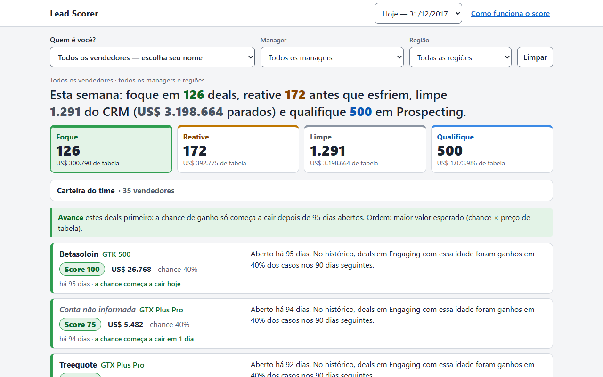
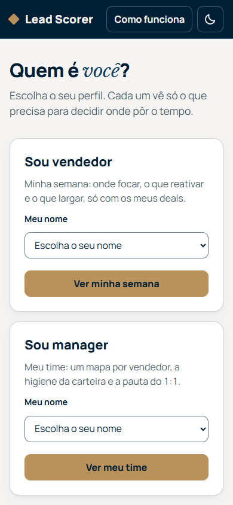

# Submissão — Rafael Pereira — Challenge 003

## Sobre mim

- **Nome:** Rafael Pereira
- **LinkedIn:** https://www.linkedin.com/in/rafael-pereira-30122003-
- **Challenge escolhido:** 003 — Lead Scorer

---

## Executive Summary

O que separa os deals do CRM é o frescor (há quanto tempo estão abertos), não o produto, o setor, a região ou o porte (todos ficam entre 60% e 65% de vitória), e a ferramenta usa isso para dizer a cada vendedor onde focar, o que reativar e o que largar. Em quatro datas passadas, os 20% de deals no topo do score concentraram em média 61,1% da receita que foi ganha depois, contra 48,1% se o time ordenasse só pelo valor, 29,7% pelos mais recentes e 20,0% num sorteio, e o critério fixado antes do teste passou sem ajuste. Hoje, 1.291 dos 1.589 deals em Engaging estão abertos há mais tempo que o maior ciclo já fechado, e a lista Limpe soma cerca de US$ 3,2 mi de valor de tabela provavelmente inflado. O ganho vem sobretudo de tirar esses deals parados do topo: entre os deals ainda vivos o score só empata com a ordenação por valor, e os dados são sintéticos. Recomendo um sprint de limpeza da lista Limpe, confirmando cada deal com o cliente antes de encerrar, e uma rotina de segunda-feira com as listas Foque e Reative.

---

## Solução

Uma página estática, sem servidor, que o vendedor abre na segunda de manhã: escolhe o próprio nome e vê quatro listas (Foque, Reative, Limpe e Qualifique), cada deal com uma explicação de 2 a 4 frases, mais um "modo teste" que mostra o que o score teria recomendado numa data passada e o que de fato aconteceu. Por trás, um motor em Python (pandas, funções puras, pytest) gera os dados da página. Documentos: [escopo](docs/SCOPE.md), [qualidade dos dados](docs/DATA_QUALITY.md), [score e validação](docs/SCORING.md), [model card](docs/MODEL_CARD.md) e [decisões](docs/DECISIONS.md).

### Como rodar (setup)

1. **Abrir a ferramenta sem instalar nada.** Duplo-clique em [`solution/app/index.html`](solution/app/index.html) (funciona em `file://`, sem servidor e sem internet).
2. **Link publicado (GitHub Pages):** https://rafael-pereira-silva.github.io/ai-master-challenge/submissions/rafael-pereira/solution/app/ (fica no ar depois que o Pages for ativado na publicação).
3. **Regenerar tudo a partir dos CSVs** (Python 3.11; testado com pandas 3.1, numpy 2.4, scipy 1.17 e pytest 9.1):

```
cd solution
pip install -r requirements.txt
python -m pytest
python -m scorer.build --reference-date 2017-12-31
```

4. **Verificação opcional da interface** (abre a página num navegador, confere contagens, filtros, layout em computador e celular, contraste e console):

```
pip install -r requirements-dev.txt
python tools/check_app.py --prefix final
```

O build é determinístico: rodar duas vezes gera os mesmos bytes. A data de referência ("hoje", 31/12/2017) é um parâmetro, não está fixa no código.

### Abordagem

1. **Do problema da Head de RevOps ao que medir.** As duas dores são tempo jogado em deal que não fecha e deal bom esfriando sem alerta. Isso não pede "qual deal tem mais chance", pede "onde ponho minha próxima hora". Por isso a métrica primária é a receita ganha capturada pelos 20% do topo, e a AUC é reportada, mas não decide. Essa regra foi escrita no [escopo](docs/SCOPE.md) antes do código de avaliação.
2. **Os dados derrubaram a ideia óbvia.** Um score por atributos dá perto de 63% para todo deal. O que separa é o ciclo: nenhum deal foi ganho depois de 138 dias, e 81% dos Engaging já passaram disso. Antes de usar qualquer coisa, limpei o que quebra o join e o que vaza: "GTXPro" contra "GTX Pro" (1.480 deals sumiriam) e os 1.425 deals sem conta, todos abertos, que funcionariam como detector de zumbi ([qualidade dos dados](docs/DATA_QUALITY.md)).
3. **O score.** Chance de ganho em 90 dias olhando só a idade do deal (curva que fica plana até um "joelho" aprendido e depois cai, sem nunca subir), vezes o preço de tabela, numa escala de 0 a 100. Os limites das listas saem da curva e do maior ciclo já ganho, não de um "se idade > 138". O vendedor não entra, e nenhum atributo entrou depois do teste ([score e validação](docs/SCORING.md)).
4. **Validação sempre no tempo.** Quatro cortes passados (30/06, 31/07, 31/08 e 30/09/2017), cada um com um modelo que só vê o que o CRM sabia naquele dia, contra três baselines: valor, recência e sorteio. O critério para "vencer" foi fixado antes do primeiro número. Um teste troca tudo o que acontece depois do corte por valores aleatórios e exige que o modelo e os scores não mudem.
5. **Interface de decisão.** Frase de ação na primeira tela ("foque em N, reative M, limpe K"), uma lista por ação, explicação por deal e o modo teste, para a Head de RevOps ver o score contra a história antes de confiar nele.

### Resultados / Findings

Cinco achados, todos gerados por script a partir do `backtest_metrics.json`:

<!-- AUTO:readme-achados -->
- **Critério pré-registrado: PASSOU, sem ajuste.** O score vence valor, recência e o sorteio nos 4 cortes.
- **Receita média no top 20%:** score 61,1%, valor 48,1%, recência 29,7%, aleatório 20,0%.
- **A recência ganha em AUC** em 3 dos 4 cortes (30/06, 31/08 e 30/09); a maior folga é em 30/09/2017, com 0,83 contra 0,65 do score. O score só ganha em AUC em 31/07.
- **Entre os deals já resolvidos o score empata com o valor:** receita média no top 20% de 48,7% contra 49,0%, e a maior diferença em um corte é de 0,5 pp. A vantagem do backtest completo vem de tirar do topo os deals parados.
- **O Foque de hoje está otimista:** 69 dos 126 deals têm 61 dias ou mais, e nos fins de trimestre testados esses deals ganharam menos que os de até 30 dias (-17,4 pp em 30/06 e -41,3 pp em 30/09). O modelo não corrige isso.
<!-- /AUTO:readme-achados -->

**Por que o score não distingue um deal de 12 dias de um de 94 dentro do Foque:** não mexi na curva depois de ver o backtest (seria ajuste pós-hoc), e o número abaixo mostra que não havia direção estável para ela seguir.

<!-- AUTO:foque-plato-sinal -->
Dentro do Foque (o platô da curva, até 95 dias), a diferença de ganhos em 90 dias entre os deals de 61 dias ou mais e os de 0 a 30 dias foi de -17,4 pp em 30/06, +19,2 pp em 31/07, +21,3 pp em 31/08 e -41,3 pp em 30/09. O sinal troca entre os cortes (2 negativos e 2 positivos), então dentro do platô não há uma inclinação estável a aprender, e é isso que justifica a curva plana até o joelho em vez de premiar os mais novos. O salto está no joelho: é depois dele que a chance cai.
<!-- /AUTO:foque-plato-sinal -->

**Backtest corte a corte** (a tabela completa, com ganhos capturados, bootstrap e calibração, está no [SCORING](docs/SCORING.md)):

<!-- AUTO:readme-backtest -->
| Corte | Receita no top 20%: score | valor | recência | aleatório | AUC do score | AUC da recência |
| :--- | ---: | ---: | ---: | ---: | ---: | ---: |
| **Média dos 4 cortes** | 61,1% | 48,1% | 29,7% | 20,0% | 0,64 | 0,70 |
| 30/06/2017 | 61,3% | 48,6% | 27,7% | 20,0% | 0,66 | 0,73 |
| 31/07/2017 | 57,9% | 48,7% | 12,8% | 20,1% | 0,64 | 0,58 |
| 31/08/2017 | 60,7% | 48,2% | 31,6% | 19,8% | 0,63 | 0,66 |
| 30/09/2017 | 64,8% | 47,1% | 46,8% | 20,3% | 0,65 | 0,83 |

Receita capturada pelos 20% de deals no topo da ordenação, como fração da receita que foi de fato ganha depois. Aleatório = média de 200 sorteios. Cada corte usa só o que o CRM sabia naquele dia.
<!-- /AUTO:readme-backtest -->

**As quatro listas de hoje (31/12/2017):**

<!-- AUTO:readme-hoje -->
| Lista | Idade do deal | Ação | Deals | Valor de tabela |
| :--- | :--- | :--- | ---: | ---: |
| Foque | até 95 dias | avançar | 126 | US$ 300.790 |
| Reative | 96 a 138 dias | retomar o contato | 172 | US$ 392.775 |
| Limpe | mais de 138 dias | confirmar e encerrar ou atualizar | 1.291 | US$ 3.198.664 |
| Qualifique | Prospecting (sem data) | qualificar | 500 | US$ 1.073.986 |
<!-- /AUTO:readme-hoje -->

O Limpe tem zero ganhos nos quatro cortes do backtest, por construção do dataset. A lista Reative teve de 0% a 23% de ganhos nos cortes: promete mais do que entregou em fim de trimestre.

**A interface** (computador e celular; dados reais, tirados por `tools/check_app.py`):





Atributos testados e descartados (um por vez, com a regra fixada antes): produto, região, setor e porte. A região parecia ajudar dentro da amostra de treino e piorou fora dela em três dos quatro cortes, que é o motivo de a validação ser temporal.

### Recomendações

Para a Head de RevOps, em ordem de prioridade:

1. **Sprint de limpeza da lista Limpe.** São 1.291 deals e cerca de US$ 3,2 mi de valor de tabela. Limpe quer dizer confirmar com o cliente e então encerrar ou atualizar, não descartar: o deal parado pode ser CRM desatualizado. Feito isso, o pipeline passa a mostrar o que é vivo.
2. **Rotina de segunda-feira com Foque e Reative.** Cada vendedor abre o próprio brief, trabalha o Foque e dá um contato de retomada no Reative. Ao ler o Foque de hoje, desconfie dos deals com 61 dias ou mais: hoje é fim de trimestre, e nos fins de trimestre testados esses deals ganharam menos que os novos.
3. **Higiene do CRM.** Preencher a conta (1.425 deals não têm), registrar a data em que o deal entrou em Prospecting (os 500 não têm, e por isso não podem ser pontuados) e guardar o histórico de estágios. Sem isso, a lista Qualifique não tem prova e o score só enxerga "dias desde o engajamento".
4. **Não usar win rate por vendedor.** A diferença entre vendedores é compatível com ruído (qui-quadrado p=0,26). Cobrar ou premiar com base nela pune pessoas por acaso.
5. **Recalibrar com dados reais.** Este dataset é sintético. Rodar o mesmo backtest, com o mesmo critério fixado antes, num CRM real, a cada trimestre (regras de recalibração no [model card](docs/MODEL_CARD.md)).

### Limitações

- **Dataset sintético.** O teto de 138 dias, a regra de fechar no trimestre do engajamento ou no seguinte e os fechamentos rápidos no primeiro mês do trimestre são padrões do gerador. Estão documentados e não são explorados, mas o Limpe herda o teto de 138 dias; em CRM real um deal mais velho pode ser ganho.
- **A vantagem vem dos zumbis.** Entre os deals já resolvidos o score só empata com o valor. A ferramenta ajuda a limpar a fila e a priorizar por valor; não prova que escolha bem entre os deals vivos.
- **A recência ganha em AUC** em três dos quatro cortes. O score ganha onde importa para a pergunta da Head de RevOps (receita), não em quem vai ganhar.
- **O Foque de hoje está otimista** para os deals com 61 dias ou mais. Medido e documentado, não corrigido no modelo.
- **Corte de 30/06 com uma foto de treino só**, e a regra "fotos a partir de 31/03" foi escolhida depois de o planejador ver o protótipo. Com 28/02 o critério também passaria; a diferença está na [seção 7 do SCORING](docs/SCORING.md).
- **Censura:** deals abertos em 31/12/2017 contam como "não ganho". Prospecting não tem score nem backtest. Horizonte de 90 dias e passo da grade do joelho não tiveram sensibilidade medida.
- **chat-exports parciais.** Só a sessão de orquestração no Claude Code tem export ([`process-log/chat-exports/`](process-log/chat-exports/sessao-orquestracao-claude-code.md)). A fase 0, feita no app do Claude, está registrada em narrativa, sem export.
- **Git:** a máquina não tinha git nem gh. O repositório foi clonado e commitado com dulwich (biblioteca Python), por um helper fora da pasta; o autor dos commits é o Rafael, com o trailer `Co-Authored-By: Claude`.
- **Interrupção por limite de API.** Os executores pararam entre 16:28 e 19:01 de 25/10/2026, no meio do bloco 3. O critério pré-registrado e o rascunho do SCORING já estavam gravados e nenhum resultado de backtest tinha sido visto antes da retomada ([log do bloco 3](process-log/03_bloco-3.md)).
- **GitHub Pages não ativado:** depende do usuário do GitHub do Rafael (marcado no setup).

---

## Process Log — Como usei IA

> **Este bloco é obrigatório.** Sem ele, a submissão é desclassificada.

**Como eu trabalhei, em uma frase:** primeiro explorei os dados em conversa com o Claude até entender o problema. Depois transformei o que aprendi em regras escritas (o "kit": [`CLAUDE.md`](CLAUDE.md), [`PROMPTS.md`](PROMPTS.md), [`GUIA.md`](GUIA.md) e [`PROMPT_AUTONOMO.md`](PROMPT_AUTONOMO.md)). Por fim, deleguei a execução a uma equipe de agentes Claude, sob controles que eu defini. Não colei o enunciado numa IA. Montei e governei um processo de desenvolvimento com IA, e cada decisão dele é auditável. O mapa completo das evidências está em [`process-log/README.md`](process-log/README.md).

### Ferramentas usadas

| Ferramenta | Para que usou |
|------------|--------------|
| Claude (app), Sonnet 5.5 e depois Opus 5.5 | Fase 0, em conversa comigo: ler o repositório, comparar os 4 challenges, explorar os dados, derrubar a hipótese "score por atributos" e validar o frescor. Depois, redigir comigo o kit de regras e prompts por bloco ([`00_fase0_exploracao.md`](process-log/00_fase0_exploracao.md)) |
| Claude Code com Opus 5.5 (orquestrador) | Executar o meu prompt de operação ([`PROMPT_AUTONOMO.md`](PROMPT_AUTONOMO.md)): preparar o ambiente, disparar e conferir os executores, consolidar os logs e commitar um bloco por vez |
| Subagente Claude Opus 5.5 (planejador, somente leitura) | Transformar o kit num plano de execução com especificação por etapa e protótipos descartáveis ([`plano_execucao_opus.md`](process-log/plano_execucao_opus.md)) |
| Subagentes Claude Sonnet e Haiku (executores) | Fazer o volume: código, testes, interface e documentos. Haiku no trabalho mecânico, Sonnet no que exige julgamento local. Cada log declara o executor |
| Subagente de contexto limpo (revisor, bloco 6) | Fazer o papel da banca: duas revisões independentes, sem acesso ao processo, com notas por critério ([`06_revisao-independente.md`](process-log/06_revisao-independente.md)) |
| Playwright + Edge, pytest, dulwich | Ferramentas que não são de IA e que eu usei para não acreditar na palavra da IA: o Playwright abre a página de verdade, o pytest prova as regras e o dulwich faz um commit por bloco |

### Workflow

**Quem fez o quê.** A IA escreveu quase todo o código e o texto. O desenho, as regras e os pontos de decisão foram meus.

| O que eu decidi ou defini | O que deleguei à IA | O controle que eu exigi para confiar no resultado |
|---|---|---|
| A escolha do 003 e a leitura da dor como "alocação de tempo", não "qual deal tem mais chance" | Escopo detalhado e respostas às 4 perguntas abertas | Cada resposta com alternativa descartada e número ([`SCOPE.md`](docs/SCOPE.md)) |
| A tese "frescor > atributos", depois que os dados derrubaram o meu plano inicial | Curva de chance por idade, score e explicações | Backtest temporal em 4 cortes contra 3 baselines, com critério e ajuste único fixados antes |
| Tirar o vendedor do score (diferença compatível com ruído) | Implementação do score | Teste de permutação: trocar os vendedores de lugar não muda nenhum score |
| "Nenhum número in-sample é resultado" e "nenhum número digitado à mão" | Limpeza, métricas e documentos | Teste que confere cada número da prosa contra os arquivos gerados; teste de mutação do futuro contra vazamento |
| Não usar Streamlit; página estática que abre com duplo-clique | Interface e build | Playwright em `file://` com 24 checagens, inclusive contagens contra o SCORING |
| Não publicar nada em meu nome sem mim | Commits locais e texto do PR | O push, o GitHub Pages e o PR ficaram reservados para mim |
| Revisão independente e "não maquie resultado" | Correções apontadas pelo revisor | Modelo, parâmetros e métrica congelados no bloco 6: crítica de modelagem vira limitação documentada, não ajuste pós-hoc |

Passo a passo:

0. **Fase 0 (eu + Claude app) e bloco 0 (setup).** Explorei os dados em conversa, achei o join quebrado ("GTXPro") e a métrica inflada, e pivotei do score por atributos para o frescor. Com isso redigi o kit: 7 decisões fechadas, um prompt por bloco com checkpoints, o guia de armadilhas e o prompt de operação. No Claude Code, o orquestrador montou o ambiente, e um executor Haiku reproduziu os números da fase 0 contra o briefing antes de qualquer código novo.
1. **Bloco 1, escopo.** Um executor Sonnet respondeu às 4 perguntas que eu tinha deixado em aberto. Cada resposta traz alternativa descartada e evidência. O executor também achou um erro no meu briefing (o produto com mais deals) e contestou com dados uma justificativa do plano.
2. **Bloco 2, dados.** Limpeza com três investigações, cada uma com critério escrito antes do resultado. Montamos a infraestrutura "todo número vem de script": blocos de documento regenerados e um teste que confere cada número da prosa.
3. **Bloco 3, score e validação.** A checagem de vazamento foi escrita antes do código, como exigi. O critério de sucesso foi registrado antes do primeiro número de desempenho. O critério passou na primeira rodada, e o ajuste único reservado não foi usado.
4. **Bloco 4, ferramenta.** Para acelerar sem perder qualidade, a interface foi construída em paralelo ao motor, a partir de um contrato de dados escrito antes. Depois a página foi verificada com Playwright, e uma passada "vendedor na segunda de manhã" corrigiu 3 atritos com screenshots de antes e depois.
5. **Bloco 5, documentação.** README e model card, com todos os números vindos de blocos regenerados e conferidos por teste.
6. **Bloco 6, revisão independente.** Dois revisores de contexto limpo avaliaram a submissão como a banca faria. As críticas de interface e documentação foram corrigidas. As de modelagem viraram texto com número, porque eu tinha congelado o modelo para evitar ajuste pós-hoc ([relatórios e triagem](process-log/06_revisao-independente.md)).

**Onde eu intervim durante a execução** (registrado no [export da sessão](process-log/chat-exports/sessao-orquestracao-claude-code.md), com horários):
- **Paralelizar sem perder qualidade.** Pedi para acelerar com trabalho paralelo, sem perder qualidade. O orquestrador redesenhou o fluxo para até 3 executores ao mesmo tempo, com posse exclusiva de arquivos e um commit por bloco.
- **Retomar sem refazer.** A cota de uso acabou no meio do bloco 3. Mandei retomar os executores de onde pararam, não recomeçar.
- **Gestão de custo.** Pedi para refinar as instruções e usar cada modelo no esforço exato. A partir daí, cada etapa teve modelo e nível de esforço escolhidos por complexidade, com executores retomados em vez de recriados.
- **Revisão final.** Revisei a entrega, alinhei a narrativa ao perfil de AI Master e reforcei as evidências ([`07_revisao-do-rafael.md`](process-log/07_revisao-do-rafael.md)).

### Onde a IA errou e como corrigi

Só episódios registrados em `process-log/` e em `docs/DECISIONS.md`. Na execução delegada, quem pegou os erros foram os controles que eu tinha exigido: verificação de números, testes de vazamento, critério pré-registrado e conferência visual.

**Na fase 0, com o Rafael:**

- **Métrica otimista (fase 0, com Rafael).** O primeiro cálculo de poder preditivo por categoria usou target encoding dentro da própria amostra e saiu inflado. Desconfiei do número, marquei como inflado e decidi exigir backtest temporal para qualquer número de desempenho.
- **Win rate de 82% no 1º trimestre tratado como possível insight (fase 0, com Rafael).** Rebaixei a achado suspeito de artefato de recorte. O bloco 2 investigou e confirmou: os fechamentos do trimestre são só de março.
- **Plano inicial com score por atributos (fase 0, com Rafael).** O plano assumia win rate por produto ou setor. Os dados mostraram todos entre 60% e 65%, e eu pivotei para o frescor.

**Na execução delegada (pego pelos controles):**

- **Erro do briefing sobre o MG Special (execução delegada).** O briefing dizia que o produto tinha o maior volume de deals, e o primeiro rascunho do escopo repetiu a frase. A regra "todo número sai dos dados" fez o executor conferir: o GTX Basic tem mais deals, e o MG Special é o segundo. O escopo e o `facts.json` foram corrigidos. O briefing, insumo da fase 0, foi mantido, com a divergência registrada.
- **Justificativa do plano para a pergunta 3 refutada (execução delegada).** O plano dizia que a chance de ganho é estável enquanto o deal é jovem, mas as fotos do briefing mostram a chance caindo desde cedo. A decisão de ordenar o Foque por valor esperado foi mantida, e a justificativa foi trocada.
- **Generalização indevida (execução delegada).** Uma versão do escopo dizia que "fora da amostra os atributos têm AUC ≈ 0,50", mas isso vale só para as variáveis numéricas. O texto passou a dizer exatamente isso.
- **Protótipo não monotônico (execução delegada).** O protótipo do planejador gerou uma curva que sobe com a idade até 90 dias, o que não faz sentido para uma lista de prioridades. A inclinação passou a ser limitada a zero ou negativa antes do backtest. A regra de começar as fotos em 31/03 foi decidida depois de ver esse protótipo, e isso está declarado como limitação.
- **Tolerância pós-hoc na investigação 2a (execução delegada).** A tolerância de 7 dias foi escolhida depois de ver as folgas. O documento declara que a condição vale no limite e não é um teste independente.
- **`beats` com ponto flutuante (execução delegada).** Em ponto flutuante, 0,61 menos 0,60 dá 0,010000000000000009, e com isso um empate contaria como vitória no critério pré-registrado. Corrigido e coberto por teste.
- **Teste de vazamento que não provava nada (execução delegada).** Um teste passaria mesmo com a guarda quebrada. Foi trocado por um teste com o futuro mutado, e seis guardas foram estragadas de propósito para ver os testes falharem de verdade.
- **Previsão do plano falsa (execução delegada).** O plano previa que a chance sozinha nunca ordenaria melhor que a recência em AUC. Em 31/07 a AUC da chance sozinha é 0,64 e a da recência, 0,58. O SCORING registra isso como erro de previsão do plano.
- **Rascunho do SCORING com afirmações que não batiam (execução delegada).** O verificador de números acusou valores sem fonte. Uma conferência achou frases erradas, por exemplo "três fotos" onde eram duas. Tudo foi corrigido antes de fechar.
- **`pytest` que travou (execução delegada).** Uma execução passou de 10 minutos. O log registra que a causa não foi diagnosticada, em vez de inventar um motivo. Num caso parecido no bloco 4, a causa foi achada: um assert que tentava imprimir o arquivo de dados inteiro.
- **Contraste e telas vazias (execução delegada).** O script de contraste reprovou a cor da lista Reative. Além disso, a aba padrão deixava vazia a tela do vendedor com mais deals. As duas coisas foram corrigidas antes dos screenshots finais.

### O que eu adicionei que a IA sozinha não faria

O G4 descreve o AI Master como quem entende o problema antes de abrir a ferramenta, usa IA como alavanca e não como muleta, entrega algo que funciona e sabe o que automatizar e o que não automatizar. Trabalho com governança de IA, e foi com esse olhar que conduzi o desafio: tratei o meu próprio uso de IA como um sistema que precisa de regras, rastreabilidade e um humano responsável.

- **Entendi o problema antes de construir.** Li a dor da Head de RevOps como alocação de tempo, não como previsão. Daí vieram as quatro listas de ação e a métrica "receita capturada no topo". Escolhi o 003 porque o entregável é verificável e porque explicabilidade e validação são exatamente o meu campo.
- **Desconfiei dos números certos.** Desconfiei da métrica inflada da fase 0, do win rate de 82% que parecia insight e do teto de 138 dias que parecia regra de negócio. Nos três casos a IA apresentou o número com confiança, e nos três o contexto mostrou que era artefato. Isso virou regra do projeto: nenhum número in-sample é resultado.
- **Coloquei justiça antes de acurácia.** O vendedor ficou fora do score, porque a diferença entre vendedores é compatível com ruído e usá-la puniria pessoas por acaso. A regra virou um teste de permutação e uma linha do model card dizendo que a ferramenta não serve para avaliar vendedores.
- **Governei a IA como governo modelos.** Apliquei ao processo os mesmos controles que aplico a sistemas de IA:
  - separação de funções (quem planeja não executa, quem revisa não viu o processo);
  - critério de sucesso registrado antes do teste, com um único ajuste permitido;
  - trilha de auditoria (uma decisão por linha, com a alternativa descartada);
  - verificação automática de cada número publicado;
  - revisão independente com poder de crítica real.
- **Decidi o que não automatizar.** Automatizei o volume: código, testes, documentos, revisão. Reservei para mim a escolha do problema, a tese, a regra de justiça e a publicação em meu nome. E deixei escrito antes, no prompt de operação, que o modelo só teria um ajuste e que o resultado não seria maquiado. Essa regra funcionou quando os dois revisores criticaram o mesmo ponto (dentro do Foque, o score equivale ao preço): a IA não mexeu na curva depois de ver o backtest. Mantenho essa escolha. Um gradiente de idade dentro do Foque é o próximo passo, mas com dados reais e um novo backtest, não como remendo para melhorar a nota.
- **Exigi honestidade sobre os limites.** Pedi resultado sem maquiagem. Por isso a entrega diz onde o score perde (a recência ganha em AUC; entre deals vivos ele só empata com o valor) e por que a lista Limpe se chama "Limpe" e não "Descarte": um deal parado pode ser só CRM desatualizado.
- **Usei IA como alavanca, com custo sob controle.** Desenhei a operação: Opus planeja, Sonnet e Haiku executam em paralelo, e um revisor de contexto limpo faz o papel da banca. Durante a execução, ajustei modelo e esforço para entregar dentro da cota, sem cortar validação nem process log.

---

## Evidências

Tudo está nesta pasta. O índice, que liga cada pergunta da banca ao arquivo que a responde, é o [`process-log/README.md`](process-log/README.md).

- [x] Screenshots da ferramenta com dados reais: [computador](process-log/screenshots/final_inicio_1280.png), [celular](process-log/screenshots/final_inicio_390.png), e os pares antes/depois dos 3 atritos corrigidos em [`process-log/screenshots/`](process-log/screenshots/).
- [ ] Screen recording do workflow
- [x] Chat exports: o [export da sessão de orquestração](process-log/chat-exports/sessao-orquestracao-claude-code.md), gerado por script a partir do export oficial do app. Traz as minhas mensagens com horário, o que o orquestrador fez em resposta e cada subagente disparado (modelo e esforço). A fase 0, feita no app do Claude, está registrada em narrativa em [`00_fase0_exploracao.md`](process-log/00_fase0_exploracao.md).
- [x] Git history: um commit por bloco (`bloco 0` a `bloco 7`), autor Rafael Pereira, com o trailer `Co-Authored-By: Claude`.
- [x] Outro: o kit que escrevi antes de delegar: [`CLAUDE.md`](CLAUDE.md) (7 decisões fechadas), [`PROMPTS.md`](PROMPTS.md) (um prompt por bloco com checkpoints), [`GUIA.md`](GUIA.md) (armadilhas) e [`PROMPT_AUTONOMO.md`](PROMPT_AUTONOMO.md) (regras de operação e de honestidade do process log).
- [x] Outro: o plano do planejador ([`plano_execucao_opus.md`](process-log/plano_execucao_opus.md)), os logs por bloco (de [00](process-log/00_bloco-0.md) a [07](process-log/07_revisao-do-rafael.md)), o [DECISIONS](docs/DECISIONS.md) com uma linha por decisão, e as saídas e scripts da fase 0 ([`outputs/`](process-log/outputs/), [`scripts/`](process-log/scripts/eda.py)).
- [x] Outro: duas revisões independentes de contexto limpo, com notas, triagem e correções, em [`process-log/06_revisao-independente.md`](process-log/06_revisao-independente.md).
- A data de envio é preenchida por mim ao abrir o PR.

---

_Submissão enviada em: [preencher ao abrir o PR]_
